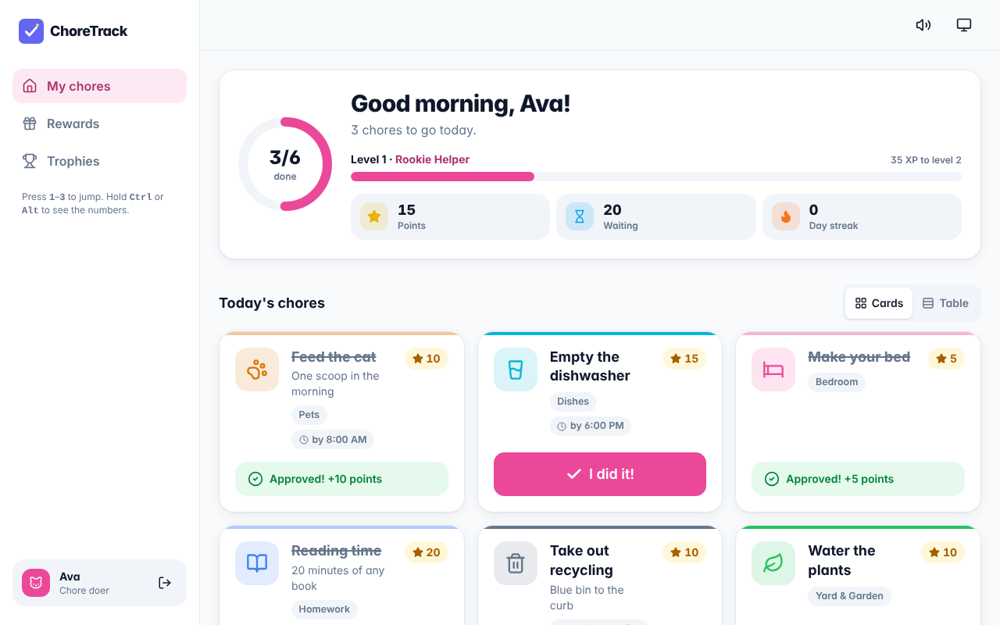

<div align="center">

<a href="https://github.com/shambles07/choretrack/releases/latest">
    <picture>
        <source media="(prefers-color-scheme: dark)" srcset="docs/assets/banner-dark.svg">
        
    </picture>
</a>

#### A stupid simple, all-in-one chore tracker for families. Built by engineers, for engineers.

[](https://github.com/shambles07/choretrack/releases)
[](docs/installation.md)
[](docs/installation.md#-docker)
[](LICENSE)

[Features](#-features) • [Quick start](#-quick-start) • [Commands](#%EF%B8%8F-commands) • [Docs](#-docs) • [Changelog](CHANGELOG.md)

</div>

---

Parents add chores. Kids tick them off, get confetti and a jingle, and earn points **once a parent approves**. Points buy rewards and unlock levels, streaks and trophies. It's one Node.js process and one SQLite file on a Raspberry Pi, a Mac or Docker. There are no accounts to sign up for, nothing in the cloud and no tracking.

<picture>
    <source media="(prefers-color-scheme: dark)" srcset="docs/assets/screenshot-dark.png">
    
</picture>

> [!IMPORTANT]
> ChoreTrack is built for **one household on a trusted home network**. Keeping it simple has meant security is basic: don't expose it to the internet. Stronger security and data handling are a long-term goal. See [docs/security.md](docs/security.md).

## ✨ Features

| | |
| --- | --- |
| 👨‍👩‍👧 **Two kinds of accounts** | Parents sign in with a password; kids tap their avatar and enter a PIN |
| ✅ **Parent approval** | Points count only after a parent approves; chores can be sent back with a note |
| 🏆 **Game layer** | XP levels, day streaks, 12 trophies and a reward shop |
| 🎉 **Celebrations** | Confetti and original jingles, made in the browser with no audio files |
| 🎨 **Your colours** | Light and dark modes; each person's favourite colour is their accent |
| 📱 **Any screen** | Phone, tablet and desktop, in card or table view; installable as an app |
| ⌨️ **Keyboard first** | Number keys switch pages, with the right key symbols for your OS |

## 🚀 Quick start

```bash
git clone https://github.com/shambles07/choretrack.git && cd choretrack
make deploy
```

Open <http://localhost:3030>. The first visit creates the parent account.

> [!NOTE]
> That's the Docker route. To run on Node.js 22+ instead, use `make install build start`. A Raspberry Pi service, a macOS login item and time zone setup are covered in [docs/installation.md](docs/installation.md).

## 🛠️ Commands

| Command | Does |
| --- | --- |
| `make deploy` | Build and start the Docker container |
| `make docker-update` · `make update` | Update to the latest release (Docker · native) |
| `make logs` · `make stop` | Follow the container's logs · stop it |
| `make export WHAT=all` | Print chores, users, scores or all as JSON |
| `make change` · `make release` | Record a change · cut a release |
| `make` | List every command |

The server takes flags too: `-p`/`--port`, `-x`/`--export`, `-h`/`--usage`. See [docs/cli.md](docs/cli.md).

## 📚 Docs

| | |
| --- | --- |
| 🚀 [Installation](docs/installation.md) | Docker, Raspberry Pi, macOS, updating, configuration, backups |
| 🧹 [Using ChoreTrack](docs/usage.md) | Accounts, approvals, points, levels and trophies |
| ⌨️ [Keyboard shortcuts](docs/keyboard-shortcuts.md) | Every shortcut, for macOS and Windows/Linux/FreeBSD |
| 💻 [Command line](docs/cli.md) | Server flags and data export |
| 🔒 [Security](docs/security.md) | What's protected, known gaps and the roadmap |
| 🏷️ [Releasing](docs/releasing.md) | Versioning and the changelog with changie |
| 🧑‍💻 [Development](docs/development.md) | Running tests and finding your way around the code |

## 📜 License

Released into the public domain under [the Unlicense](LICENSE).
